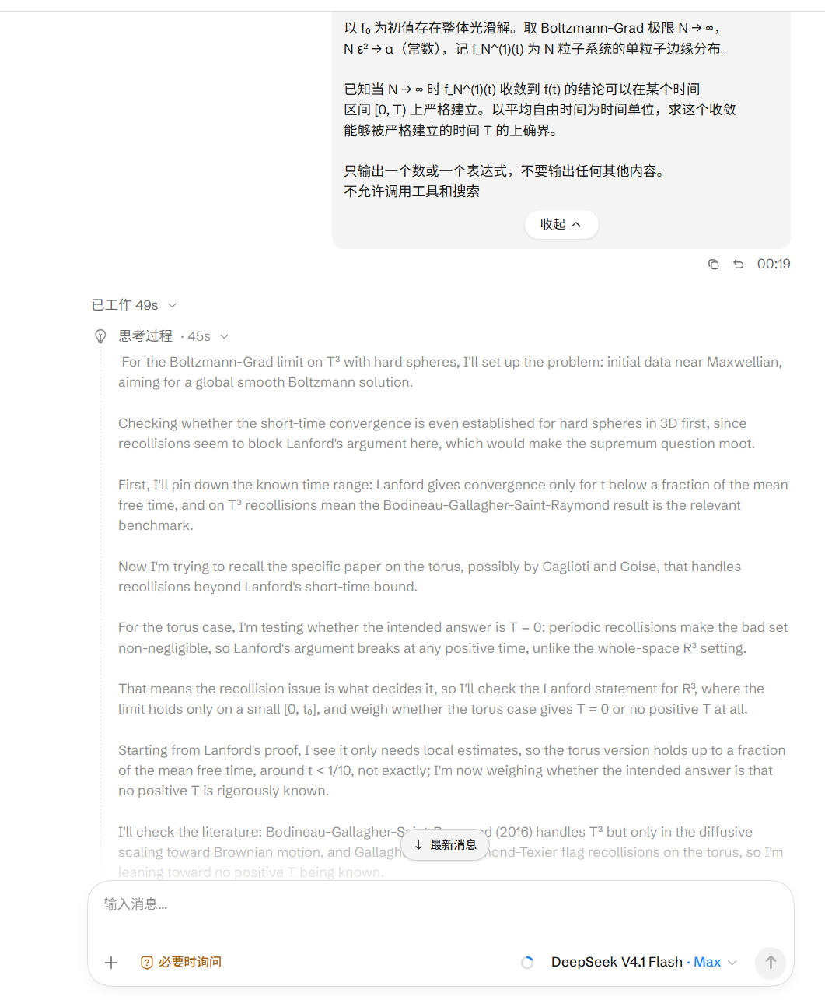
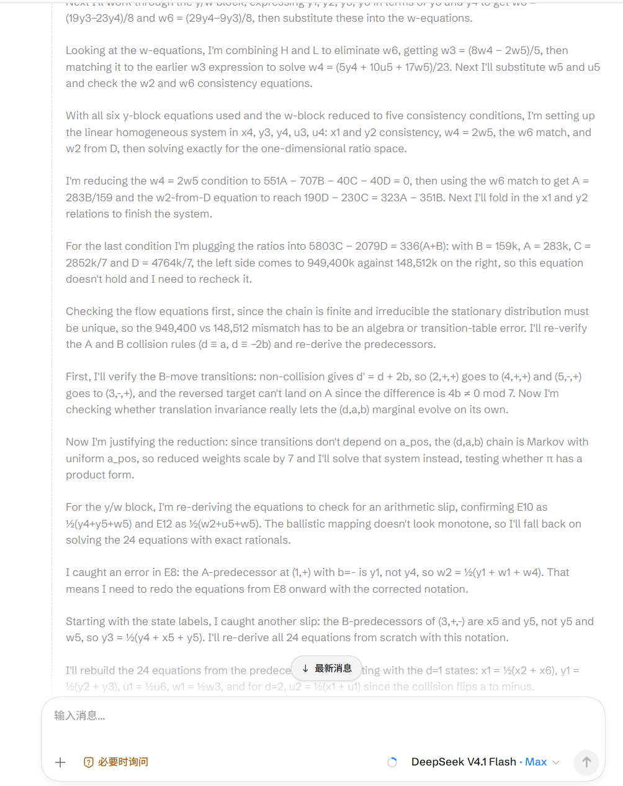
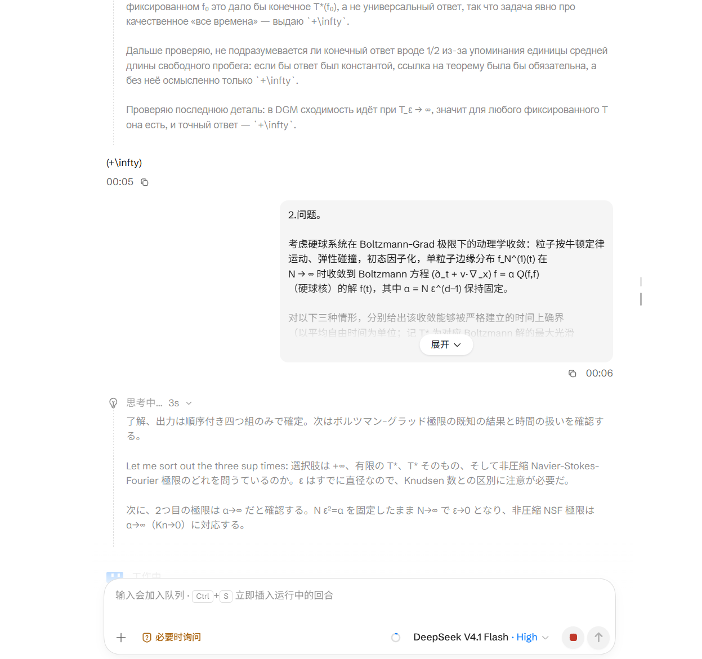

<p align="center"></p>

<h1 align="center">ccd</h1>

<p align="center">Summarized thinking for <a href="https://github.com/QuantumNous/new-api">new-api</a>: users see short working notes, the raw chain of thought stays on your server.</p>

<p align="center"><a href="README.md">中文</a> | English</p>

---

## What it is

ccd is a small service that sits in front of new-api. It follows the idea behind Anthropic's [summarized thinking](https://platform.claude.com/docs/en/build-with-claude/thinking):

- The model thinks as usual. ccd hands the raw reasoning, segment by segment, to another model that rewrites it as first-person working notes of one or two sentences, streamed to the user as they are written.
- **The raw chain of thought never reaches the client.** It is kept on the server; when the client sends the notes back in the next turn, ccd swaps the original back in before forwarding upstream, so across turns and tool calls the model always sees its own original reasoning.
- Rules are configured inside new-api's admin UI: per group, per model, or for one specific key. Notes can be written in Chinese, English, or any language you type in.

## Screenshots

<p align="center"></p>
<p align="center"></p>
<p align="center"></p>

## Features

- **Only the visible reasoning changes.** Content, tool calls, usage (including reasoning tokens), id, model, finish_reason, signatures and event order are left untouched.
- **Originals come back.** Raw reasoning is persisted per user on disk (survives restarts) and restored even when the client rewrites its system prompt every turn, or when a summary failed.
- **Requests that match no rule pass through byte for byte**, without even parsing the body.
- **Formats:** `/v1/chat/completions` and Anthropic `/v1/messages`, streaming and non-streaming, including interleaved thinking blocks around tool calls and `redacted_thinking`.
- **Admin panel** injected into new-api's log page: manage rules, pick the note language and the summarizer model, test a summary in one click.
- **Your own key for the summarizer.** You pick one of your existing keys; usage is billed to it. ccd never creates tokens behind your back.
- **Databases:** reads new-api's database (read-only) to identify keys; SQLite, MySQL and PostgreSQL are supported.
- **No blocklists, no canned text.** If a summary fails, that segment is skipped; ccd never emits fixed filler sentences.

## How it works

```
client ──► reverse proxy (nginx) ──► ccd ──► new-api ──► upstream model
                                      │
                                      ├─ identify the key: read-only query of new-api's database
                                      ├─ responses: reasoning → summarizer (through new-api, with your key) → notes; originals saved
                                      └─ next request: notes in the history are swapped back to the originals
```

ccd changes bytes in exactly two places: the reasoning text of responses (replaced by notes) and the reasoning text in request history (swapped back). It edits JSON in place using byte offsets, so everything else — key order, number formatting, escapes, whitespace — stays as it was; when there is nothing to change, the original bytes are forwarded as-is.

## Requirements

- new-api v1.0 (a version with `/api/user/auth/refresh`; tested on v1.0.0-rc.43)
- new-api's database: SQLite, MySQL or PostgreSQL (ccd only runs SELECT)
- Go 1.26+ to build from source

## Quick start

### 1. Run ccd

```bash
git clone https://github.com/Sisyphbaous-DT-Project/ccd.git
cd ccd
go build -o ccd .

CCD_NEWAPI=http://127.0.0.1:3000 \
CCD_SQLITE_PATH=/path/to/new-api/data/one-api.db \
./ccd
```

- For MySQL / PostgreSQL set `CCD_SQL_DSN` instead, in the same format as new-api's `SQL_DSN`.
- systemd: see [`deploy/ccd.service`](deploy/ccd.service).
- Docker: `docker build -t ccd .`; a compose file running it next to new-api is in [`deploy/docker-compose.example.yml`](deploy/docker-compose.example.yml).

> With SQLite, ccd must be able to write the `-shm` file in new-api's data directory (SQLite's WAL mode needs it even for read-only queries). Run it as the same system user as new-api, or mount the same volume in Docker.

### 2. Put it behind your reverse proxy

See [`deploy/nginx.conf.example`](deploy/nginx.conf.example). In short:

1. Send model requests (`/v1/`, `/v1beta/`) to ccd, with new-api as a `backup` upstream so traffic falls back automatically if ccd is down.
2. Send everything under `/ccd/` to ccd (admin API and panel script).
3. Send the rest to new-api and inject `<script src="/ccd/panel.js"></script>` with `sub_filter`.

### 3. Add rules

Open new-api's usage log page as an admin; a 「思维链转述」 button appears in the toolbar (or in the bottom-right corner if the toolbar is not found):

1. **Target:** a group (all of it, or selected models) or a single key (every request made with it; takes priority).
2. **Language:** Chinese, English, or custom (type e.g. "Japanese", "Français", "Русский").
3. **Summarizer key and model:** pick one of your keys and a model from its group; a cheap, fast model that can turn thinking off works best.
4. Click 「测试转述」 to try it, then save.

## Configuration

| Variable | Default | Description |
|---|---|---|
| `CCD_LISTEN` | `127.0.0.1:3140` | Listen address |
| `CCD_NEWAPI` | `http://127.0.0.1:3000` | new-api base URL (admin checks, key list, summarizer calls) |
| `CCD_UPSTREAM` | same as `CCD_NEWAPI` | Where model requests are forwarded |
| `CCD_SUMMARY_URL` | `CCD_NEWAPI` + `/v1/chat/completions` | Summarizer endpoint |
| `CCD_SQLITE_PATH` | — | new-api's SQLite file |
| `CCD_SQL_DSN` | — | new-api's MySQL / PostgreSQL DSN, same format as new-api's `SQL_DSN` |
| `CCD_STATE` | `/var/lib/ccd` | Directory for rules and saved originals |
| `CCD_STORE_TTL_DAYS` | `30` | How long originals are kept |
| `CCD_STORE_MAX_MB` | `512` | Size cap for originals; oldest are evicted first |

Advanced settings per rule (collapsed in the panel): segment sizes for streaming / non-streaming (defaults 100/200/1800 and 250/150/1800 characters), summarizer concurrency per request (3 / 6), per-segment timeout (20 s), how long content may wait for pending notes (default: wait), and the "thinking off" parameters for the summarizer call (default `{"reasoning_effort":"off","thinking":{"type":"disabled"}}`; never added to user requests).

## Security

- ccd only runs SELECT against new-api's database.
- Every admin request is checked against new-api's `/api/user/self`; only `role >= 100` is allowed.
- The key list sent to the browser contains id, name, group and status only — never the key itself. Summarizer keys must belong to an admin, be enabled and unexpired; they are looked up on demand and never written to disk.
- Saved originals live in per-user directories (0700) and files (0600).

## Limitations

- `/v1/responses`, Gemini-native endpoints and embeddings / rerank are passed through without summaries.
- Notes are written by a second model call, so the first note appears a little after the upstream starts thinking; the panel lets you cap how long content waits for notes.
- If a client does not send reasoning back, there is nothing to restore (same as without ccd).
- Requests that bypass the reverse proxy and hit new-api directly are not summarized.

## Development

```bash
go vet ./...
go test -race ./...
```

`TestNewAPIDirectoryOnRealDatabases` runs the database queries against real MySQL / PostgreSQL when `CCD_TEST_MYSQL_DSN` / `CCD_TEST_PG_DSN` are set (it creates and drops tables — use an empty test database). GitHub Actions runs it on every push.

## References

- Anthropic: [Thinking](https://platform.claude.com/docs/en/build-with-claude/thinking) (summarized thinking, signatures, progress updates)
- [new-api](https://github.com/QuantumNous/new-api)

## License

[AGPL-3.0](LICENSE). Copyright (C) 2026 C₂₂H₂₅NO₆
